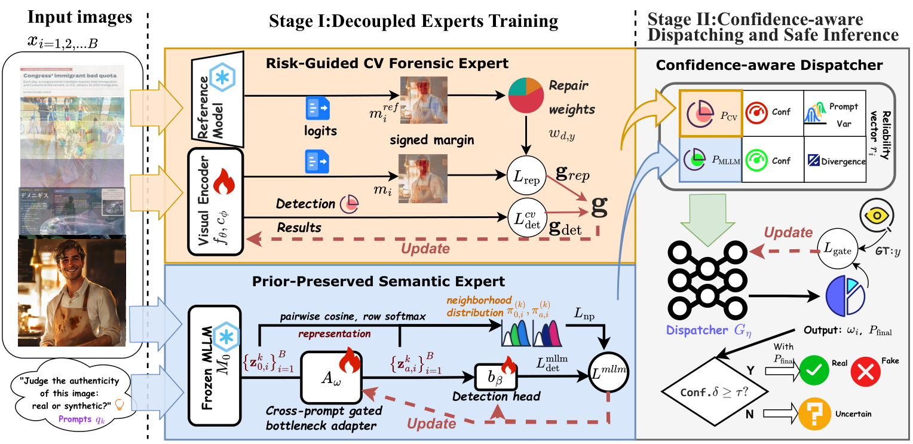

# DECD

Decoupled Experts with Confidence-Aware Dispatching for Cross-Domain AI-Generated Image Detection.

DECD combines a risk-guided Visual Expert, a frozen-backbone Semantic Expert, and a confidence-aware Dispatcher.



## Installation

Use Python 3.10+ and install a suitable PyTorch build, then:

```bash
python -m pip install -r requirements.txt
```

Run the commands below from the repository root in Bash (Linux/WSL). Training configurations are in `configs/`. Model initialization weights are downloaded or read from local caches; trained DECD checkpoints are not bundled.

## MOSAIC data

MOSAIC is distributed separately. Use its predefined Train/Validation/Test partitions (4,200/600/1,200 images). The expected layout is:

```text
data/
  images/...
  manifests/
    mosaic_train.csv
    mosaic_dev.csv
    mosaic_test.csv
```

Use numeric labels `0` (Real), `1` (Fake), and domains `Cartoon`, `Chart`, `Photo_and_poster` (`Photo` is accepted). Image paths are relative to each CSV. Both experts must use the same CSVs and nonempty, unique `sample_id` values. Example schema:

```csv
sample_id,image_path,domain,label,split
cartoon_real_001,../images/cartoon_real_001.jpg,Cartoon,0,train
```

Optional `split` values are `train`, `dev`/`validation`/`val`, and `test`. Update YAML manifest paths if needed; YAML paths resolve from the parent of `configs/`. No dataset-construction scripts are required.

CSV loading uses image paths, labels, domains and optional `group_id`. Split checks cover repeated paths and supplied groups, not duplicate image bytes under different filenames.

## Visual Expert

The full-data configuration uses 700 reference updates, a fixed Train-only risk profile, then 14 cycles of B100/B50 training with Real-side repair and adaptive auxiliary-gradient scaling:

```bash
visual_config=configs/visual_expert_mosaic_v2_full.yaml
visual_checkpoint=outputs/mosaic_v2_full/visual_expert/visual_expert.pth
python scripts/train_visual_expert_alternating.py --config "$visual_config"
```

Add `--dry-run` for CPU data preflight or `--resume` for checkpoint continuation. For FP32, select `configs/visual_expert_mosaic_v2_fp32.yaml` and its corresponding checkpoint path. For the alternative B100 → risk → B50 protocol, use the defaults in `configs/visual_expert_reported.yaml`:

```bash
python scripts/train_reference.py
python scripts/build_risk_profile.py
python scripts/train_visual_expert.py
```

For this alternative, set `visual_config=configs/visual_expert_reported.yaml` and `visual_checkpoint=outputs/visual_expert/visual_expert.pth` in subsequent commands. The reference command accepts `--pretrained-path weights/ViT-L-14.pt` for trusted compatible local initialization.

Visual-only inference with the selected configuration and checkpoint:

```bash
python scripts/evaluate_visual_expert.py --config "$visual_config" --checkpoint "$visual_checkpoint" --manifest data/manifests/mosaic_test.csv --output-dir outputs/visual_test
```

## Semantic Expert

Cache frozen Qwen2.5-VL features for Train/Validation, then train the adapter and head. These commands use `configs/mllm_expert_reported.yaml` by default:

```bash
for split in train dev; do
  python scripts/extract_mllm_features.py \
    --manifest data/manifests/mosaic_${split}.csv \
    --output outputs/mllm_features/${split}_features.pt
done
python scripts/train_mllm_expert.py
```

## Dispatcher and evaluation

After both experts are trained, generate aligned outputs for all three partitions. Dispatcher `eval` corresponds to the official Test split; only Train/Validation are used for training and calibration.

```bash
for split in train dev eval; do
  manifest=data/manifests/mosaic_${split}.csv
  if [ "$split" = eval ]; then
    manifest=data/manifests/mosaic_test.csv
    python scripts/extract_mllm_features.py \
      --manifest "$manifest" --output outputs/mllm_features/eval_features.pt
  fi
  python scripts/evaluate_visual_expert.py \
    --config "$visual_config" --manifest "$manifest" \
    --checkpoint "$visual_checkpoint" --output-dir outputs/visual_eval/${split}
  python scripts/build_dispatcher_signals.py \
    --features outputs/mllm_features/${split}_features.pt \
    --mllm-checkpoint outputs/mllm_expert/mllm_expert.pth \
    --cv-predictions outputs/visual_eval/${split}/predictions.csv \
    --output data/signals/${split}_signals.csv --device cuda:0
done
python scripts/train_dispatcher.py
python scripts/evaluate_dispatcher.py --signals data/signals/eval_signals.csv
```

Dispatcher defaults are in `configs/dispatcher_reported.yaml`. Evaluation writes metrics and per-sample predictions under `outputs/`. For Visual-only inference, run `evaluate_visual_expert.py` with the desired manifest and checkpoint. Use a fresh output directory for each run.

Known limitations: semantic caches do not reject split overlap/NaNs, and signal joins do not check label conflicts. Tied-confidence abstention and per-domain metrics at nondefault decision thresholds have known edge cases. Real-model benchmark reproduction has not been rerun for this release cleanup.

License: [Apache-2.0](LICENSE). See [third-party notices](decd/visual_expert/THIRD_PARTY_NOTICES.md) for dependency and model/data licensing boundaries.
